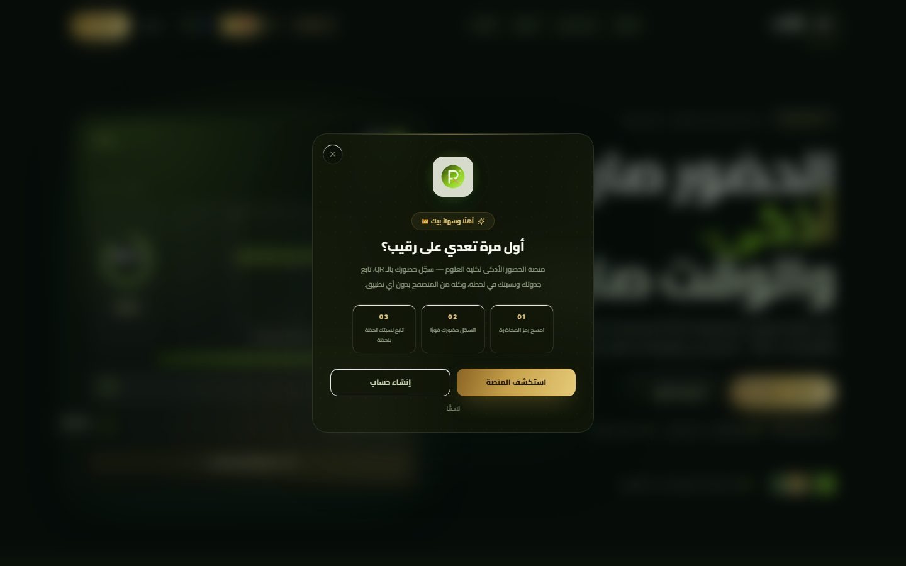
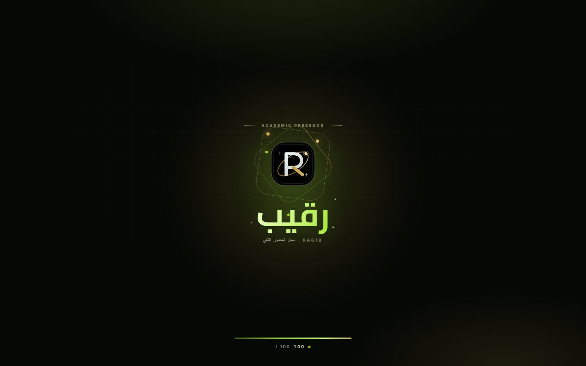
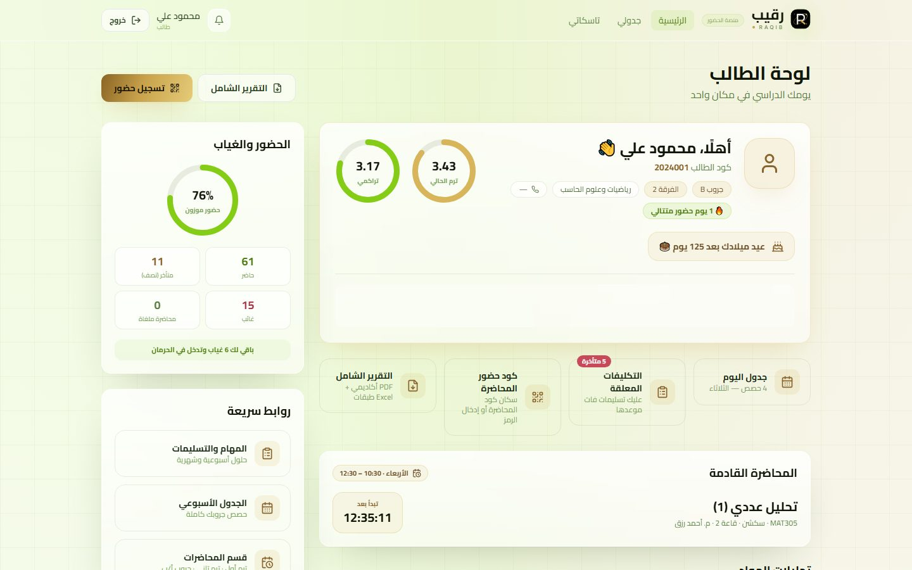

<div align="center">

# 🏛️ رقيب — RAQiB

**منصة إدارة الحضور والمحاضرات الأكاديمية — كلية العلوم، جامعة السويس**

[](https://github.com/budiabdallah20/raqib/actions/workflows/verify.yml)
[](https://raqibdev.vercel.app/)


**English:** RAQiB is a full academic-operations platform — QR attendance, rosters and scheduling,
grades with GPA tracking, multi-role auth (student/professor/admin), auditing and a live status
page. Built with Next.js 15 + TypeScript + Prisma, deployed on Vercel with strict security headers.

</div>

<div dir="rtl">

## ✨ الميزات الأساسية

| | |
|---|---|
| 🔐 **مصادقة متعددة الطبقات** | JWT (كوكيز HttpOnly) + Passkey/WebAuthn (بصمة الجهاز) + bcrypt-12 + rate-limit |
| 🧾 **حضور بـ QR دوراني** | رمز QR جديد كل 20 ثانية بصلاحية قصيرة + كود يدوي من 6 أرقام + منع المسح المتكرر |
| 🪧 **لوحة عرض المحاضرة** | QR عملاق + عدّاد تنازلي + عدد الحاضرين لحظياً + آخر 5 عمليات مسح |
| 🗓️ **جداول بالسحب والإفلات** | ترتيب المواد داخل خلايا الجدول (تبديل كامل) مع تراجع — والسيرفر هو صاحب القرار |
| 📊 **إدارة أكاديمية كاملة** | الطلاب، هيئة التدريس، المواد، الكويز/الأعمال/الميدترم، وإعدادات النظام من لوحة الأدمن |
| 🧮 **حساب GPA تدريجي** | تقدير تراكمي صريح يخضع لسياسة النظام القابلة للضبط |
| 🛡️ **أمان افتراضي صارم** | CSP مقفلة، HSTS، سجل تدقيق لكل العمليات الحساسة، وسرية الرموز |
| 🩺 **صفحة `/status`** | فحوص صحة حية تحسب مباشرة من قاعدة البيانات وتعرض حالة كل مكوّن |
| 📬 **استعادة كلمة المرور** | عبر Resend (اختيارية) مع توقيع محمي في الإنتاج |

## 🖼️ لقطات الشاشة

| الهبوط | تسجيل الدخول | لوحة الطالب |
|:---:|:---:|:---:|
|  |  |  |

## 🧱 البنية التقنية

| الطبقة | التقنية |
|---|---|
| الواجهة والسيرفر | Next.js 15 (App Router) · React 19 · Turbopack للتطوير |
| اللغة | TypeScript 5.6 بصرامة كاملة (`tsc --noEmit` في الـ CI) |
| قاعدة البيانات | Prisma 5 + SQLite تطويراً · PostgreSQL للإنتاج |
| التنسيق | Tailwind CSS 3 بهوية عربية RTL مخصصة (ذهبي/فحمي) |
| الحركة | Framer Motion |
| الاختبار | Vitest 5 (وحدات) · Playwright (شاملة E2E) |
| النشر | Vercel (HTTP/3) · GitHub Actions للحماية |
| التشغيل البديل | Docker (وفي المستودع Dockerfile و docker-compose) |
| التطوير المحلي | HTTPS موقّع عبر mkcert مع server.mjs على المنفذ 5000 |

## 🚀 التشغيل المحلي

```bash
git clone https://github.com/budiabdallah20/raqib.git
cd raqib
npm ci
cp .env.example .env        # ثم عدّل القيم إن لزم
npm run db:push
npm run db:seed
npm run dev                  # http://localhost:3000
# أو HTTPS موقّع محلياً:
npm run dev:https            # https://localhost:5000
```

بديل بضغطة واحدة:

```bash
docker compose up --build
```

### حسابات تجريبية (بعد تشغيل الـ seed)

| الدور | البريد | كلمة المرور |
|---|---|---|
| أدمن | `admin@raqib.edu` | `Admin@123` |
| دكتور | `professor@raqib.edu` | `Prof@123` |
| طالب | `student@raqib.edu` | `Student@123` |

> ⚠️ حسابات البذرة للتطوير فقط — غيّرها في أي بيئة حقيقية.

## ⚙️ متغيرات البيئة

انسخ `.env.example` إلى `.env` محلياً، أما قيم الإنتاج فتوضع مشفرة على Vercel:
**Project Settings → Environment Variables** (اكتب القيم الحقيقية هناك ولا ترفعها للشيفرة أبداً).

| المتغير | الهدف | ملاحظات الإنتاج |
|---|---|---|
| `DATABASE_URL` | الاتصال بالقاعدة | تطويراً: `file:./dev.db` · إنتاجاً: سلسلة Postgres مع `sslmode=require` |
| `JWT_SECRET` | توقيع الجلسات | سر 64 حرف — ولّده: `node -e "console.log(require('crypto').randomBytes(48).toString('base64url'))"` |
| `ADMIN_ACCESS_CODE_HASH` | كود دخول الإدارة (bcrypt-12) | ولّده: `npm run admin:code` |
| `NEXT_PUBLIC_APP_URL` | العنوان الرسمي | `https://raqibdev.vercel.app` |
| `TRUST_PROXY` | ثقة رؤوس X-Forwarded خلف بروكسي | `1` على Vercel / Nginx |
| `PASSKEY_RP_ID` | نطاق WebAuthn | نطاق الإنتاج بدون `https://` ولا مسارات |
| `RESEND_API_KEY` | البريد لاستعادة كلمة المرور | اختياري |
| `ALLOW_DEMO_RESET` | تفعيل مسح البيانات التجريبية | يجب أن يبقى `0` في الإنتاج |
| `SHOW_DEV_RESET_CODE` | إظهار كود الاستعادة في استجابة API | يجب أن يكون `0` في الإنتاج (أمان) |

## 📜 الأوامر المتاحة

| الأمر | الوظيفة |
|---|---|
| `npm run dev` | خادم تطوير على 3000 (Turbopack) |
| `npm run dev:https` | خادم تطوير HTTPS موقّع على 5000 |
| `npm run build` | بناء إنتاج (يشغّل `prisma generate` أولاً — مطلب Vercel) |
| `npm run verify` | بوابة الجودة الكاملة: `tsc` + بناء + اختبارات |
| `npm test` | اختبارات الوحدات (Vitest) |
| `npm run test:e2e` | اختبارات Playwright التفاعلية |
| `npm run db:push` / `db:seed` / `db:studio` | إدارة قاعدة البيانات |
| `npm run db:backup` / `db:audit` / `db:verify` | النسخ الاحتياطي والتدقيق والتفتيش |
| `npm run security:env` | تدقيق الأمان وصحة متغيرات البيئة |
| `npm run admin:code` | توليد هاش كود دخول الإدارة |
| `npm run screenshots` | التقاط لقطات شاشة التوثيق |

## 🔒 الأمان — الوضع الافتراضي

- **Content-Security-Policy**: `self` فقط بلا أي مصدر خارجي، مع `frame-ancestors 'none'`.
- **رؤوس إلزامية** — HSTS مع `preload`، nosniff، COOP/CORP، وسياسة صلاحيات مقيّدة (كاميرا الجهاز للمتصفح نفسه فقط).
- **كلمة السر** تُخزن بـ bcrypt-12، والجلسة في كوكيز HttpOnly موقّعة بـ JWT.
- **Passkey/WebAuthn** كخيار دخول ثانٍ بلا كلمة مرور، مربوط بنطاق الإنتاج.
- **سجل تدقيق** يحفظ الحرج: الدخول/الخروج، إنشاء حسابات، تعديل مسارات مستخدم، تعديل كورس أو محاضرة، إلخ.
- **سر الرموز**: كود استعادة كلمة المرور محجوب عن استجابات الـ API في الإنتاج (`SHOW_DEV_RESET_CODE=0`).
- **لا فهرسة** لصفحات اللوحات (`X-Robots-Tag: noindex`) — محركات البحث لا ترى إلا الهبوط العام.
- شفرة المصدر لا تحتوي أي سر؛ الأسرار تُدار داخل بيئات Vercel المشفرة أو ملفات بيئية محلية مستثناة من Git.

## ☁️ النشر على Vercel

المستودع موصول بالمشروع تلقائياً:

- أي **push** إلى `main` → بناء ونشر production تلقائي.
- أي branch آخر أو PR → نشر **Preview** بعنوان مؤقت.

```text
الرابط الرسمي: https://raqibdev.vercel.app
صفحة الحالة:   https://raqibdev.vercel.app/status
```

خطوات الاعتماد الحقيقية:

1. ضبط متغيرات الإنتاج (الجدول أعلاه) في Vercel Dashboard — مشفرة افتراضياً.
2. قاعدة بيانات PostgreSQL (Vercel Postgres/Neon أو Supabase) وتوجيه `DATABASE_URL` إليها.
3. `prisma db push` مرة واحدة على قاعدة الإنتاج لإنشاء الهيكل، ثم بذرة أدمن واحد.
4. افتح `/status` بعد النشر للتأكد أن كل الفحوص أخضر.

## 🔁 GitHub Actions — بوابة الجودة

`.github/workflows/verify.yml` تُشغّل على كل push إلى `main` وعلى كل Pull Request:

| الخطوة | فحص |
|---|---|
| `actions/checkout` + `npm ci` | تثبيت نظيف مطابق تماماً للـ lock-file |
| `prisma generate` | عميل Prisma مطابق للمخطط |
| `tsc --noEmit` | صفر أخطاء أنواع |
| `vitest run` | اختبارات الوحدات |
| `next build` | بناء إنتاج حقيقي بمتغيرات CI معزولة |

مع تعادل: Node 24 (مطابق لـ Vercel)، cache للاعتماديات، حد 15 دقيقة، وتفريغ (concurrency) يلغي التشغيلات المتقادمة.
**المبدأ**: أي سقوط في الـ CI = مشكلة حقيقية داخل الكود، بلا صمت ولا استثناءات مخفية — لذلك الـ build الأخضر موثوق.

## 🗂️ هيكل المشروع

```
src/
├─ app/          # Next.js App Router: الصفحات و API
│  ├─ (auth)/    # تسجيل ودخول
│  ├─ admin/     # لوحة الأدمن: الطلاب، الدكاترة، المواد، الجداول، الإعدادات
│  ├─ professor/ # لوحة الدكتور: الدرجات، المواد، التقارير
│  ├─ student/   # مساحة الطالب: الحضور، الجدول، الملف، المهام
│  └─ api/       # واجهات REST محروسة بالأدوار
├─ components/   # مكونات الواجهة
├─ lib/          # لب المشروع: db, security, i18n, passkey...
└─ middleware.ts # الدرع الأمني وسياسات المسارات
prisma/          # schema + seed
scripts/         # أدوات الصيانة (نسخ احتياطي/تدقيق/تحقق)
tests/           # Vitest + Playwright
docs/            # توثيق موسع (هوية/هندسة/عرض/سيناريو)
```

## 🧰 النسخ الاحتياطي والتشغيل المحلي

- **الإنتاج المحلي:** `npm run build` ثم `npm start` → `https://localhost:5000` (شهادة mkcert من `certs/`).
- **نسخة احتياطية يدوية:** `npm run db:backup` — أو مجدولة كل 6 ساعات (Task Scheduler: `RAQiB DB Backup`)، آخر 20 نسخة.
- **Google Drive:** ثبّت Google Drive للكمبيوتر واختر مجلد `RAQiB-Backups` كمجلد مزامنة — كل نسخة جديدة ترفع للدرايف تلقائيًا بلا أي كود.
- **التهجير إلى Postgres عند الحاجة:** `npm run db:dump` → `npm run db:push:pg` → `npm run db:restore` (البناء يختار لغة Prisma تلقائيًا من DATABASE_URL).

## 📚 توثيق إضافي

| الملف | المحتوى |
|---|---|
| [`docs/ARCHITECTURE.md`](docs/ARCHITECTURE.md) | القرارات الهندسية والبنية الداخلية |
| [`docs/BRAND.md`](docs/BRAND.md) | نظام الهوية والألوان والخطوط |
| [`docs/PITCH.md`](docs/PITCH.md) | العرض التقديمي للمشروع |
| [`docs/DEMO-SCRIPT.md`](docs/DEMO-SCRIPT.md) | سيناريو العرض الحي |

## 📄 الترخيص

مشروع أكاديمي خاص — **كلية العلوم، جامعة السويس**. جميع الحقوق محفوظة © 2026.

للإبلاغ عن مشكلة: افتح [Issue](https://github.com/budiabdallah20/raqib/issues) في المستودع.

</div>
